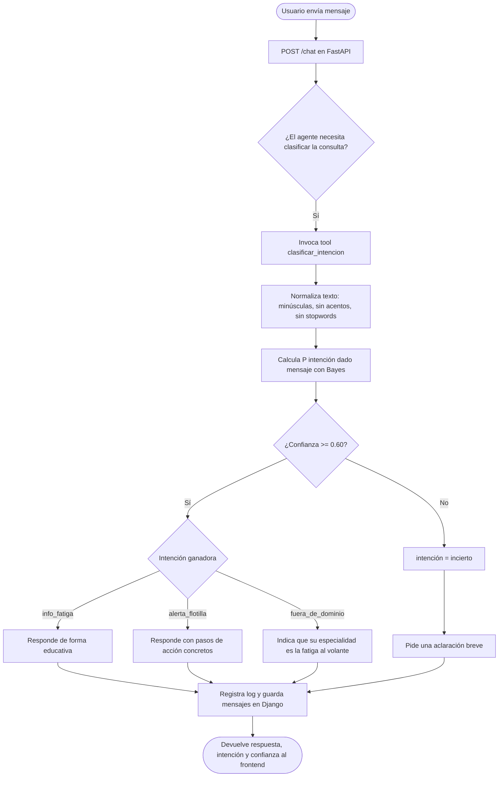

# Flujo de decisión del agente (SCRUM-34)

**Técnica de IA elegida:** razonamiento probabilístico con el Teorema de Bayes
(clasificador Naive Bayes, `Backend/bayes_router.py`, SCRUM-29).

**Capacidad que requiere el agente:** decidir de forma autónoma *qué tipo de consulta*
recibió para responder con el enfoque adecuado.

## 1. Cuándo se invoca la técnica

El agente invoca la herramienta `clasificar_intencion` en **cada mensaje nuevo del
usuario**, antes de redactar la respuesta final. La herramienta se expone con `@tool`
(SCRUM-37, `Backend/herramienta_bayes.py`).

## 2. Diagrama de decisión

## 3. Reglas de decisión

| Condición | Intención | Comportamiento del agente |
|---|---|---|
| Pregunta conceptual sobre fatiga o somnolencia | `info_fatiga` | Respuesta educativa y clara |
| Caso concreto de un conductor o unidad con alerta | `alerta_flotilla` | Pasos de acción concretos |
| Tema ajeno a la fatiga al volante | `fuera_de_dominio` | Aclara su especialidad y ofrece ayuda en el tema |
| Probabilidad máxima menor a 0.60 | `incierto` | Pide una aclaración breve |

## 4. Entradas y salidas de la herramienta

- **Entrada:** `mensaje` (texto del usuario).
- **Salida:** `intencion`, `confianza` y `probabilidades` por clase.
- **Umbral de confianza:** 0.60 (parámetro `umbral` de `ClasificadorBayes`).

## 5. Relación con las demás tareas del sprint

- SCRUM-35: lógica base del clasificador (`bayes_router.py`).
- SCRUM-37: la función se expone como `@tool` (`herramienta_bayes.py`).
- SCRUM-38: las instrucciones del sistema indican al agente cuándo usar la herramienta.
- SCRUM-39: registro de logs dentro de la herramienta.
- SCRUM-40: evidencias de ejecución para el documento final.
